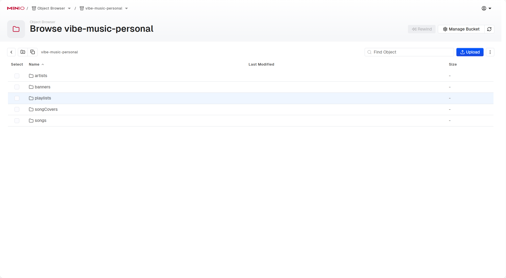
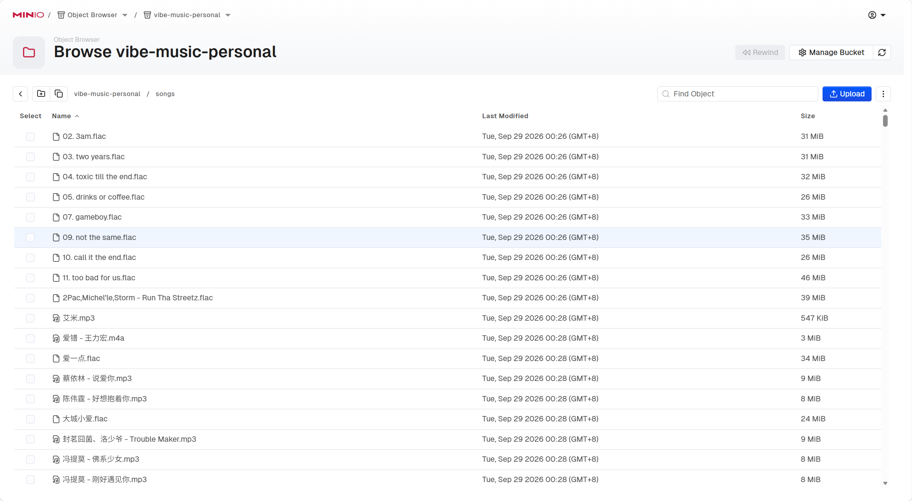

# JOJO MUSIC Server 🎶

## 项目简介

**JOJO MUSIC Server** 是 JOJO MUSIC 的后端服务，负责提供音乐数据、用户认证、内容管理、文件存储、缓存与 API 逻辑支持。

本项目基于 **Spring Boot 3 + Java 25 + Maven + MyBatis-Plus** 构建，并结合 **MySQL、Redis、MinIO、JWT** 等组件，为前端客户端和管理后台提供稳定的业务接口。

## 主要功能

- 用户认证与权限控制
- 歌手、歌曲、歌单、轮播图管理
- 歌词导入：管理员后台导入 LRC 歌词，自动匹配歌曲库记录并支持预览、确认导入
- 歌手资料自动补全：基于 MusicBrainz + Wikipedia/Wikidata + Wikimedia Commons 自动补全歌手简介、性别、国籍、头像（仅补充空字段，不覆盖已有资料，支持 HTTP 代理）
- 音频上传校验：校验音频文件完整性并提取 MP3 时长，防止上传损坏或异常音频
- 多对多艺人关联：支持歌曲多艺人（feat/合作）解析与搜索命中
- 评论、收藏、反馈处理
- 文件上传与静态资源存储（MinIO）
- 自定义背景上传：`PATCH /user/uploadUserBackground` 将用户壁纸存入对象存储的
  `backgrounds/` 前缀并返回可访问 URL；校验 MIME 白名单与**文件头魔数**（防止改扩展名绕过），
  限制 20MB，且需登录调用
- Redis 缓存与热点数据优化（缓存 key 按用户隔离，避免收藏状态跨账号串显）
- 邮件验证码等扩展能力

## 技术栈

- Spring Boot 3
- Java 25 (LTS)
- Maven
- MySQL 8+
- Redis
- MinIO
- MyBatis-Plus
- JWT
- Druid

## 系统要求

- JDK 25+
- Maven 3.9+
- MySQL 8.0+
- Redis 6.0+
- MinIO

## 仓库地址

- GitHub: https://github.com/timi669/jojo-music-server
- Client: https://github.com/timi669/jojo-music-client
- Admin: https://github.com/timi669/jojo-music-admin

## 环境准备

1. 安装并启动 MySQL
2. 安装并启动 Redis
3. 安装并启动 MinIO
4. 创建数据库（示例）

   ```sql
   CREATE DATABASE jojo_music CHARACTER SET utf8mb4 COLLATE utf8mb4_unicode_ci;
   ```

5. 修改 `src/main/resources/application.yml` 中的数据库、Redis 和 MinIO 配置；邮件配置通过环境变量提供：`MAIL_HOST`、`MAIL_PORT`（默认 `587`）、`MAIL_USERNAME` 和 `MAIL_PASSWORD`。`MAIL_PASSWORD` 应使用邮箱服务商提供的 SMTP 授权码，不要提交到版本库。
6. 对已有数据库执行 `sql/migrations/002_add_artist_metadata_sources.sql`，为歌手简介扩容并保存图片/简介来源链接。

## 歌手资料自动补全

管理员可在后台“歌手管理”页点击“自动补全缺失资料”。任务会扫描歌曲记录所引用的 MinIO MP3/FLAC 文件中的艺人标签，按 Unicode 规范化后的姓名去重，只创建歌手表中尚不存在的艺人，再对歌手库执行资料补全。匹配采用 MusicBrainz 唯一精确姓名结果；同名歧义或没有可靠资料的条目会跳过并列出原因。已有头像会保留；成功匹配到的新简介、性别和国籍会更新数据库中的对应值。

简介优先来自中文 Wikipedia 页面；性别和国籍来自对应 Wikidata 实体的结构化属性。头像仅在 Wikimedia Commons 提供了可验证许可信息时下载，并存入 MinIO。来源信息保留在数据库中。任务在服务端后台运行，管理页会显示扫描/补全进度和跳过/失败名单。

如果后端运行环境不能直连这些站点，可让后端进程使用本机 V2Ray 的 **HTTP 代理端口**。设置环境变量 `ARTIST_METADATA_PROXY_HOST` 和 `ARTIST_METADATA_PROXY_PORT` 后再启动后端，例如 Windows PowerShell：

```powershell
$env:ARTIST_METADATA_PROXY_HOST = "127.0.0.1"
$env:ARTIST_METADATA_PROXY_PORT = "10809"
.\mvnw.cmd spring-boot:run
```

请在 V2Ray 客户端设置中确认实际的 HTTP 监听端口（`10809` 只是常见默认值；不要填 SOCKS 端口）。若后端由 IDE、Windows 服务或其他启动器运行，需在那个后端进程的环境变量中设置这两个值，并重启后端使配置生效。不设置代理变量时仍使用原有直连方式。

## 构建与运行

1. 构建项目

   ```bash
   mvn clean package -DskipTests
   ```

2. 运行服务

   ```bash
   java -jar target/jojo-music-server-0.0.1-SNAPSHOT.jar
   ```

3. 如需本地调试，可使用

   ```bash
   mvn spring-boot:run
   ```

## 项目脚本

- `mvn clean`：清理构建产物
- `mvn compile`：编译项目
- `mvn test`：运行测试
- `mvn package`：打包可执行 JAR
- `mvn spring-boot:run`：启动 Spring Boot 应用

## 测试与持续集成

- 单元测试基于 JUnit 5 + Mockito，覆盖角色权限、缓存 key 隔离、
  删除歌手的数据保护、音频上传校验、歌词导入、歌手资料补全、艺人署名解析等
- 运行：`mvn test`

  > ⚠️ 其中 `JojoMusicServerApplicationTests`（需真实数据源装配）与
  > `RedisConnectionTest`（**会写入/删除真实 Redis**）依赖本机环境，
  > 运行前请确认目标环境，避免误操作生产数据。

- CI：`.github/workflows/ci.yml` 在 push / PR 到 `main` 时执行编译与
  **离线安全的测试集**（刻意排除上述两个需真实依赖的测试类）

## 数据资源示例




## 依赖服务说明

本项目运行依赖以下服务：

- MySQL：持久化数据
- Redis：缓存和会话相关能力
- MinIO：音乐文件、图片等静态资源存储

## 版权与免责声明

本项目仅供学习、研究和个人技术实践使用。

- 请勿用于任何违法、侵权或商业用途
- 数据来源、文件授权和部署环境必须由使用者自行确认合法合规
- 因使用本项目造成的任何后果，由使用者自行承担

## 许可证

本项目遵循 MIT 许可证，详情请查看 [LICENSE](LICENSE)。

## 贡献

欢迎提交 Issue、Pull Request 或改进建议，帮助完善 JOJO MUSIC Server。