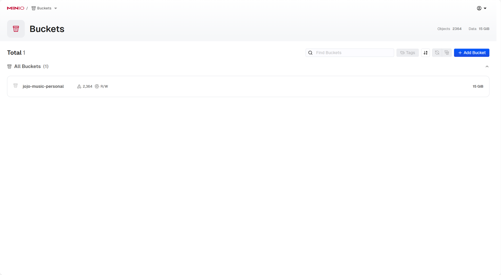
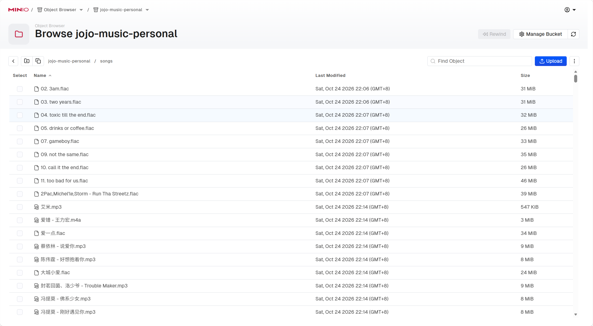

# JOJO MUSIC Server 🎶

## 项目简介

**JOJO MUSIC Server** 是 JOJO MUSIC 的后端服务，负责提供音乐数据、用户认证、内容管理、文件存储、缓存与 API 逻辑支持。

本项目基于 **Spring Boot 3 + Java 25 + Maven + MyBatis-Plus** 构建，并结合 **MySQL、Redis、MinIO、JWT** 等组件，为前端客户端和管理后台提供稳定的业务接口。

## 主要功能

- 用户认证与权限控制
- 歌手、歌曲、歌单、轮播图管理
- 歌词导入：管理员后台导入 LRC 歌词，自动匹配歌曲库记录并支持预览、确认导入
- 歌手资料自动补全：自动补全歌手简介、性别、国籍、头像（仅补充空字段，不覆盖已有资料）。数据源以**网易云音乐 + 百度百科**为主力，默认不依赖境外站点
- 歌词自动抓取：按需从网易云抓取带时间轴的 LRC 并写入库，已有歌词不会被覆盖（走乐观锁）
- 音频上传校验：校验音频文件完整性并提取 MP3 时长，防止上传损坏或异常音频
- 多对多艺人关联：支持歌曲多艺人（feat/合作）解析与搜索命中
- 评论、收藏、反馈处理
- 文件上传与静态资源存储（MinIO）
- 自定义背景上传：`PATCH /user/uploadUserBackground` 将用户壁纸存入对象存储的
  `backgrounds/` 前缀并返回可访问 URL；校验 MIME 白名单与**文件头魔数**（防止改扩展名绕过），
  限制 20MB，且需登录调用
- Redis 缓存与热点数据优化（缓存 key 按用户隔离，避免收藏状态跨账号串显）
- 邮件验证码等扩展能力

## 技术栈

- Spring Boot 3
- Java 25 (LTS)
- Maven
- MySQL 8+
- Redis
- MinIO
- MyBatis-Plus
- JWT
- Druid

## 系统要求

- JDK 25+
- Maven 3.9+
- MySQL 8.0+
- Redis 6.0+
- MinIO

## 仓库地址

- GitHub: https://github.com/timi669/jojo-music-server
- Client: https://github.com/timi669/jojo-music-client
- Admin: https://github.com/timi669/jojo-music-admin

## 环境准备

1. 安装并启动 MySQL
2. 安装并启动 Redis
3. 安装并启动 MinIO
4. 创建数据库（示例）

   ```sql
   CREATE DATABASE jojo_music_personal CHARACTER SET utf8mb4 COLLATE utf8mb4_unicode_ci;
   ```

5. 创建 MinIO bucket（默认名 `jojo-music-personal`，与 `application.yml` 中的 `minio.bucket` 保持一致），并把它的访问策略设为匿名只读，否则前端无法直接加载封面、头像与音频：

   ```json
   {
     "Version": "2012-10-17",
     "Statement": [{
       "Effect": "Allow",
       "Principal": {"AWS": ["*"]},
       "Action": ["s3:GetObject"],
       "Resource": ["arn:aws:s3:::jojo-music-personal/*"]
     }]
   }
   ```

   这里只开放 `GetObject`（匿名读）。写入与删除仍需要密钥，不要在公开 bucket 上授予 `PutObject` 或 `DeleteObject`。

6. 修改 `src/main/resources/application.yml` 中的数据库、Redis 和 MinIO 配置；邮件配置通过环境变量提供：`MAIL_HOST`、`MAIL_PORT`（默认 `587`）、`MAIL_USERNAME` 和 `MAIL_PASSWORD`。`MAIL_PASSWORD` 应使用邮箱服务商提供的 SMTP 授权码，不要提交到版本库。
7. **必须设置 JWT 签名密钥**，否则后端会使用开发用默认密钥（启动日志会打印安全告警）：

   ```bash
   # 生成一个 48 字节的随机密钥
   export APP_JWT_SECRET="$(openssl rand -base64 48)"
   ```

   Windows PowerShell：

   ```powershell
   $env:APP_JWT_SECRET = [Convert]::ToBase64String((1..48 | ForEach-Object { Get-Random -Max 256 }))
   ```

   密钥至少 32 个字符（HMAC-SHA256 要求密钥不短于摘要长度，见 RFC 7518 §3.2），且不能是单一重复字符。**不要把它写进配置文件并提交**：任何拿到源码的人都能用它伪造管理员 token，从而绕过全部登录流程。
8. 对已有数据库执行 `sql/migrations/` 下的脚本：`001_create_tb_song_artist.sql` 建立多艺人关联表，`002_add_artist_metadata_sources.sql` 为歌手简介扩容并保存图片/简介来源链接。脚本可重复执行。

## 歌手资料自动补全

管理员可在后台“歌手管理”页点击“自动补全缺失资料”。任务先扫描歌曲记录所引用的 MinIO 音频文件中的艺人标签，按 Unicode 规范化后的姓名去重，只创建歌手表中尚不存在的艺人，再对歌手库执行资料补全。

补全按以下顺序取资料，**每个字段各自取第一个非空值**：

1. **网易云音乐**（主力）：头像、简介
2. **百度百科**：简介、国籍（词条资料卡的「国籍」字段）、性别（简介中的「男/女 + 职业」表述）
3. **维基百科 / Wikidata**（可选，默认关闭）：见下方开关

安全性方面，只补充空字段，绝不覆盖已有资料；同名歌手按作品数裁决，且要求显著领先才采用，无法判定时留空而不猜测。

选择来源时做过的取舍：

- 库里的合作艺人条目（如 `王力宏&谭维维`）取**首位艺人**的资料
- 百度百科只认「国籍」，不取「民族」（民族是族群归属而非国家）
- 多国籍取第一个；资料卡里的脚注数字会被清除（否则会写出 `中国179` 这类脏值）
- 网易云条目名含译名时（如 `BTS (防弹少年团)`）按去括号后相等来匹配，避免选到同名空壳账号

若希望用维基数据补充性别/国籍，可开启：

```powershell
$env:ARTIST_METADATA_WIKIDATA_ENABLED = "true"
```

Wikidata 读的是 P27（国籍）/ P21（性别）结构属性，比解析文本可靠，并带职业门禁以挡掉同名无关条目。但它对匿名调用限流较严且需境外网络，故默认关闭。

若后端运行环境需要代理访问境外站点，可设置本机 V2Ray 的 **HTTP 代理端口**：

```powershell
$env:ARTIST_METADATA_PROXY_HOST = "127.0.0.1"
$env:ARTIST_METADATA_PROXY_PORT = "10809"
.\mvnw.cmd spring-boot:run
```

请在 V2Ray 客户端设置中确认实际的 HTTP 监听端口（`10809` 只是常见默认值；不要填 SOCKS 端口）。不设置代理变量时仍使用直连方式。

## 歌词自动抓取

约四分之一的歌曲原本没有歌词。管理端可调用两个接口：

- `POST /admin/lyrics/fetchPreview`：只查不写，返回每首歌的匹配情况供人工核对
- `POST /admin/lyrics/fetch`：抓取并写入库

两者都可留空参数，此时自动挑选尚无歌词的歌曲。写库复用带乐观锁的更新语句，**已有歌词不会被覆盖**；只接受带时间轴的 LRC（纯文本无法用于同步滚动）。

匹配时先解析艺人对应的网易云 ID，再用 ID 约束歌曲匹配，因此能正确处理库名与数据源用名不一致的情况（如库里的 `BOL4` 对应网易云的 `脸红的思春期`）。

## 构建与运行

1. 构建项目

   ```bash
   mvn clean package -DskipTests
   ```

2. 运行服务

   ```bash
   java -jar target/jojo-music-server-0.0.1-SNAPSHOT.jar
   ```

3. 如需本地调试，可使用

   ```bash
   mvn spring-boot:run
   ```

## 项目脚本

- `mvn clean`：清理构建产物
- `mvn compile`：编译项目
- `mvn test`：运行测试
- `mvn package`：打包可执行 JAR
- `mvn spring-boot:run`：启动 Spring Boot 应用

## 测试与持续集成

- 单元测试基于 JUnit 5 + Mockito，覆盖角色权限、缓存 key 隔离、
  删除歌手的数据保护、音频上传校验、歌词导入、歌手资料补全、艺人署名解析等
- 运行：`mvn test`

  > ⚠️ 其中 `JojoMusicServerApplicationTests`（需真实数据源装配）与
  > `RedisConnectionTest`（**会写入/删除真实 Redis**）依赖本机环境，
  > 运行前请确认目标环境，避免误操作生产数据。

- CI：`.github/workflows/ci.yml` 在 push / PR 到 `main` 时执行编译与
  **离线安全的测试集**（刻意排除上述两个需真实依赖的测试类）

## 数据资源示例




## 依赖服务说明

本项目运行依赖以下服务：

- MySQL：持久化数据
- Redis：缓存和会话相关能力
- MinIO：音乐文件、图片等静态资源存储

## 版权与免责声明

本项目以 **MIT 许可证**开源，代码可自由使用、修改与分发（含商业用途），
详见下方[许可证](#许可证)一节。

需要特别说明的是，**MIT 许可证只覆盖本项目的代码，不覆盖通过本项目访问的第三方内容**：

- 音乐、封面、歌词等媒体资源的版权归各自权利人所有，本项目不附带任何媒体内容授权
- 数据来源、文件授权和部署环境必须由使用者自行确认合法合规
- 请勿将本项目用于任何违法或侵权用途
- 因使用本项目造成的任何后果，由使用者自行承担

## 许可证

本项目遵循 MIT 许可证，详情请查看 [LICENSE](LICENSE)。

## 贡献

欢迎提交 Issue、Pull Request 或改进建议，帮助完善 JOJO MUSIC Server。